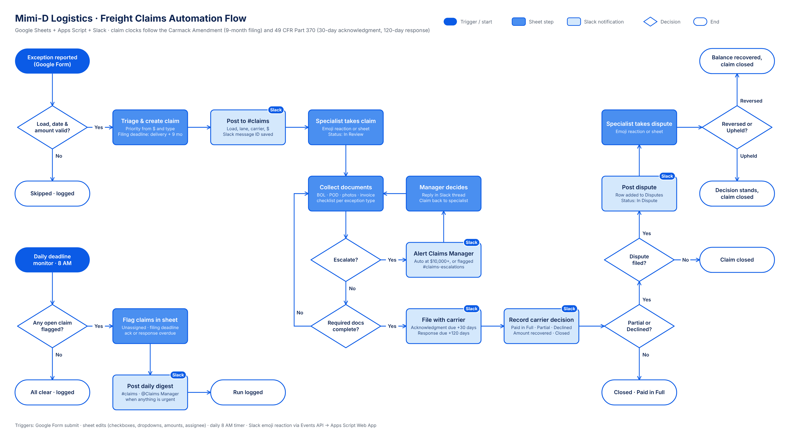

# Freight Claims & Shipment Exception System

An automated claims workflow for **Mimi-D Logistics**, a fictional regional freight brokerage. It's built on **Google Sheets, Google Apps Script and Slack**, and takes a shipment exception from report to recovery:

- **Intake and triage:** a report comes in, priority and deadlines are set automatically.
- **Routing:** a claims specialist takes the claim with an emoji reaction in Slack.
- **Filing:** documents are checked before the claim is filed with the carrier.
- **Escalation:** large claims go to the Claims Manager automatically.
- **Decision and dispute:** the carrier's decision and any dispute are recorded.
- **Deadline monitor:** a separate daily check watches the legal claim deadlines.



> All companies, people, carriers, loads and amounts in this repo are fictional.

---

## The problem

When freight arrives damaged, short, late or not at all, the broker files a claim with the carrier on the shipper's behalf. Money is lost in three ways:

- **Deadlines get missed.** Claims must be filed within 9 months of delivery (Carmack Amendment, 49 U.S.C. § 14706). Carriers must acknowledge a claim within 30 days and pay, decline or offer a settlement within 120 days (49 CFR Part 370).
- **Claims are filed incomplete,** so carriers decline them.
- **Large claims reach a manager too late,** or not at all.

This system puts every claim in one tracker, enforces the document checklist, and watches all three clocks.

## What it does

| Stage | How it works |
|---|---|
| **Intake** | A shipper, consignee, driver or dispatcher submits a Google Form (load #, carrier, lane, delivery date, exception type, amount, evidence). It becomes a row in `Claims` with a Claim ID (`CLM-00001`) and a post in `#claims`. |
| **Triage** | **Priority** is set from the amount and type: Critical ≥ $10,000, High ≥ $5,000 or any Loss, Medium ≥ $1,000. The **filing deadline** is the delivery date + 9 months. Critical claims are **auto-escalated**. |
| **Assignment** | A specialist reacts to the Slack post with their emoji. The Slack Events API calls the script's Web App, which writes `Assigned To` and stamps `Date Acknowledged`. Picking a name in the sheet does the same. |
| **Filing** | Ticking `Filed with Carrier?` is **blocked until the required documents are checked off**. The list depends on the exception type, e.g. Damage needs BOL, POD, photos and invoice. Filing stamps the date and sets the carrier's 30-day acknowledgment and 120-day response due dates. |
| **Escalation** | Automatic for Critical claims, or a specialist ticks `Escalate?`. The claim is copied to `Escalations`, and the Claims Manager is @-mentioned in `#claims-escalations`. The manager's decision is posted back in the thread. |
| **Decision** | **Paid in Full** (recovered = claimed), **Partial Settlement** (waits for the amount and checks it's between $0 and the claim) or **Declined** ($0). It's blocked until the claim has been filed. The result is posted in the claim's thread with the recovery %. |
| **Dispute** | Partial or declined claims can be disputed, one dispute per claim. The outcome is **Reversed** (the unpaid balance is recovered) or **Upheld**. Final Recovered syncs back to `Claims`. |
| **Deadline monitor** | Daily at 8 AM, every open claim is checked for: unassigned 2+ days, filing deadline within 30 days or passed, carrier acknowledgment overdue, carrier response past 120 days. Flags are written to the sheet and posted as **one digest**, which @-mentions the manager when anything is urgent. |

## Design choices

- **Idempotent.** Every handler checks what has already happened before acting, using date stamps, destination rows and a `Notification Status` tag. Re-running a trigger never duplicates a row or a Slack post.
- **Rules live in one place.** Thresholds, the deadline clocks and the per-type document checklist are in `Rules.gs`.
- **Columns found by header name,** not letter, so the sheet can be rearranged.
- **Mock mode.** With `SLACK_MODE = mock`, every message goes to a `Notification Log` tab instead of Slack. The whole flow can be demoed without a Slack workspace, and a demo function simulates emoji reactions.
- **No secrets in code.** The bot token and channel IDs live in Script Properties.
- **One claims table.** Outcomes stay on the claim row, so reporting reads from one clean table.

## Tech stack

Google Sheets · Google Forms · Google Apps Script (V8) · Slack Web API (`chat.postMessage`) · Slack Events API (`reaction_added`) · Block Kit

## Repository layout

```
apps-script/
  Rules.gs       business rules: thresholds, deadline clocks, document checklist, statuses
  Intake.gs      form submission → triage → Claim ID → Slack → auto-escalation
  Routing.gs     Slack Events endpoint (doPost) + specialist assignment
  Workflows.gs   carrier filing, acknowledgment, escalation, decision, dispute
  Monitor.gs     daily deadline monitor
  Slack.gs       Slack posting (live or mock) + Block Kit layouts
  Utils.gs       sheet, date and money helpers
flowchart.png    automation flowchart
```

## How it runs

| Trigger | Calls |
|---|---|
| Google Form submission (installable `onFormSubmit`) | `onFormSubmitHandler` → `createClaim_` |
| Sheet edit (installable `onEdit`) | the matching handler in `Workflows.gs` or `assignSpecialist_` |
| Daily time trigger, 8 AM | `runDeadlineMonitor` |
| Slack `reaction_added` event → Apps Script Web App | `doPost` → `handleReaction_` |

Secrets and Slack IDs (`SLACK_BOT_TOKEN`, `CLAIMS_CHANNEL_ID`, `ESCALATION_CHANNEL_ID`, `MANAGER_SLACK_ID`, `SLACK_VERIFICATION_TOKEN`, `SLACK_MODE`) are read from Script Properties and never stored in code.

## Not included

This repository shows the automation logic. The **sheet design** (tab structure, column layout, dropdowns, formatting), the **intake form builder** and the **trigger and menu setup** are my own work and are kept private, so the code here is a showcase rather than a one-click install. A walkthrough or live demo is available on request.

## Roadmap

- Sample dataset and Metabase dashboard: claims by carrier and exception type, $ claimed vs. recovered, recovery rate, days to resolve, deadline breaches
